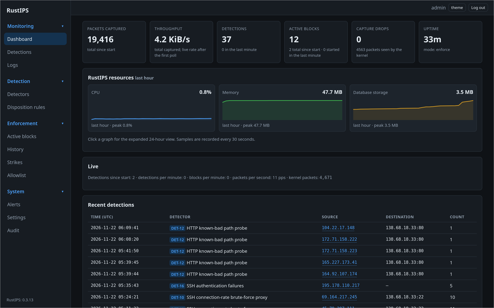
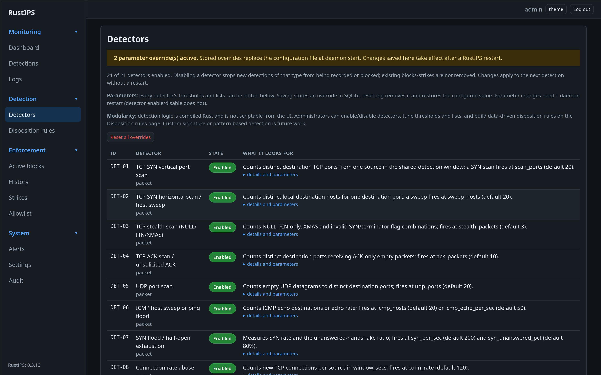
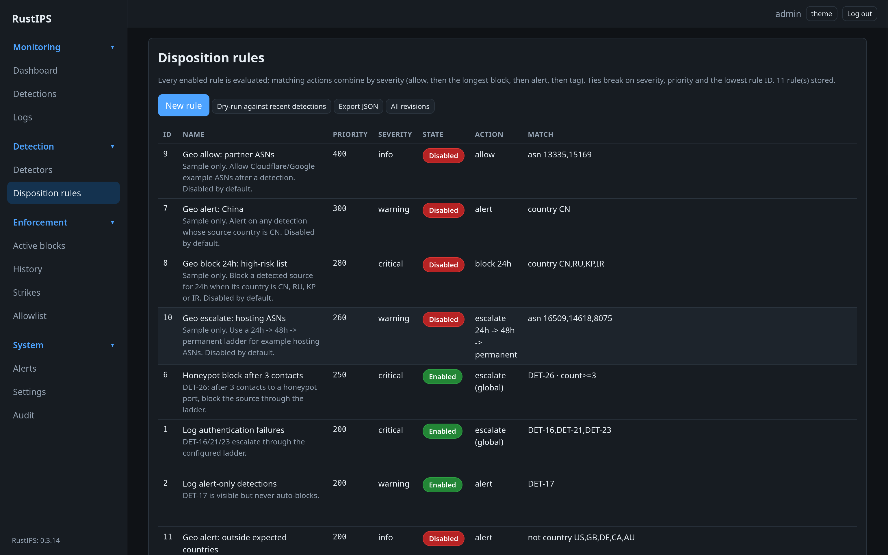
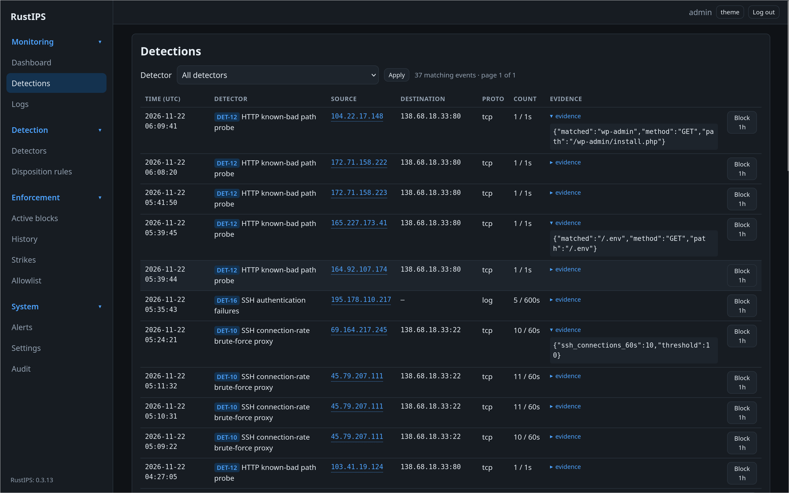
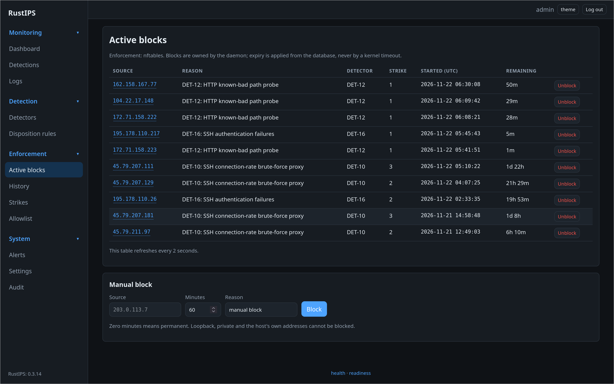
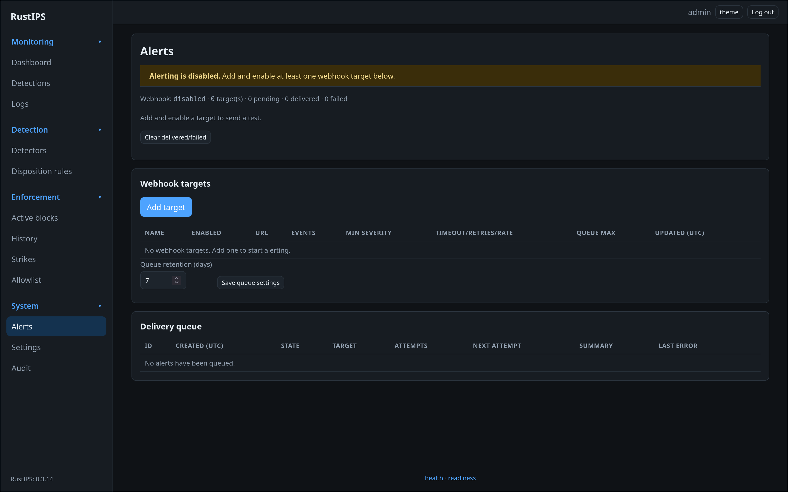
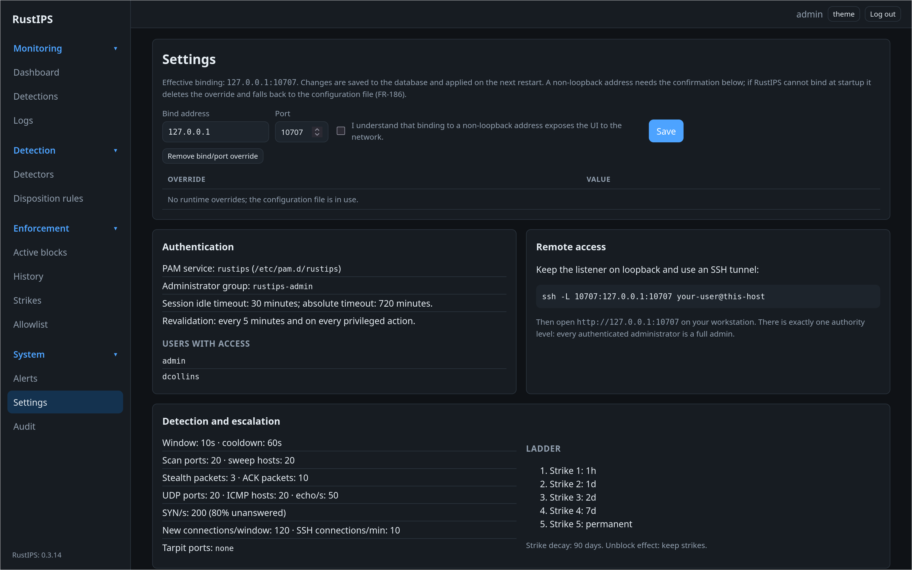
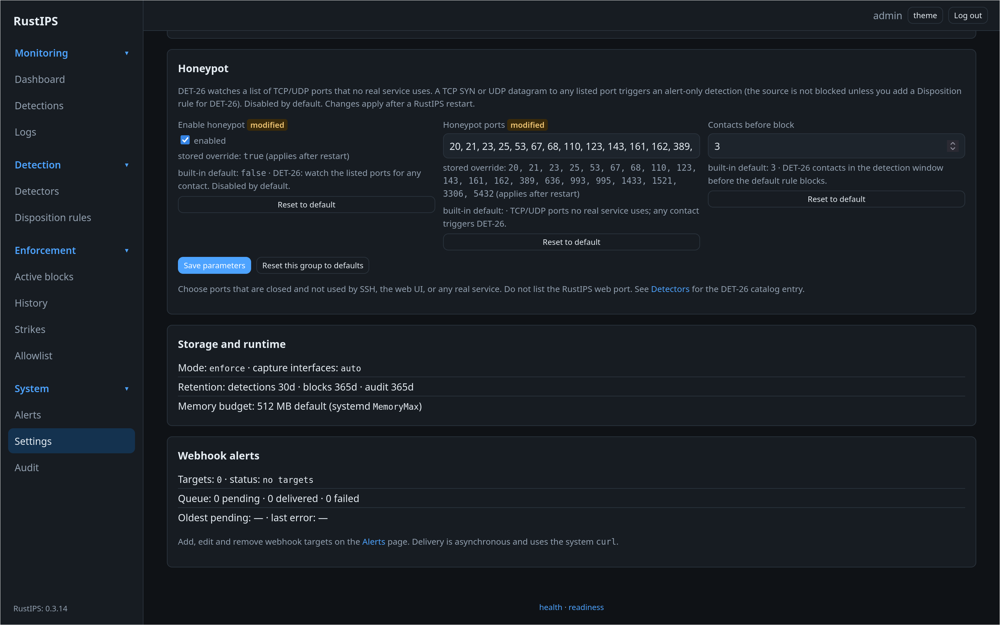
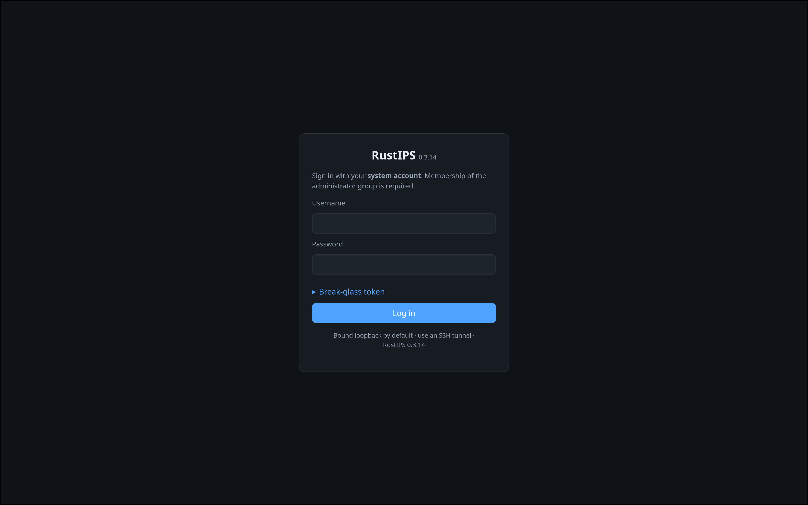

# RustIPS

RustIPS is a small, fast intrusion prevention system for a **single**
internet-facing Linux host. It watches packets, recognises the common
automated attacks, and blocks the source address at the firewall.

**Project website:** <https://rustips.tech/> — product overview, screenshots and
the design story.

This repository currently contains **0.3.14**: the packet sensor, web UI,
journald ingestion, rules platform, HTTP detectors, GeoIP/ASN enrichment,
webhook alerting, slow-scan detection, the full-detector coverage gate, the
distribution/first-run experience, a detector catalog with per-detector
enable/disable, editable parameters with reset-to-default, collapsible
grouped left-sidebar navigation, flash-free theme loading, an optional packet
honeypot (DET-26), a per-source IP history dialog with country/ASN and a
permanent-block action, and dashboard CPU/memory/database-storage graphs with a
24-hour history dialog. The single binary installs itself
with `setup --install-service`, captures traffic, runs detectors DET-01…17/20…26,
parses HTTP access logs that reach the journal, stores evidence in SQLite,
applies the configured rules and strike ladder, enforces blocks with nftables,
and serves an embedded web UI on loopback with PAM authentication. Detector
logic is compiled Rust; custom detection signatures are not scriptable.
File-only log sources and the optional eBPF/XDP capture path remain later work.

## Status

| Area | 0.3.14 |
|---|---|
| Live capture (AF_PACKET) and pcap replay | yes |
| Detectors | packet: DET-01…15, slow-scan DET-20 and honeypot DET-26 (block after 3); log: DET-16/17/21/23 |
| Host-log ingestion | journald via supervised `journalctl -f -o json`, cursor resume, bounded event store |
| Disposition rules | data-driven rules with validation, revisions, dry-run, import/export, country/ASN conditions, disabled sample geo rules |
| GeoIP / ASN | disposition-only compact range indexes, checksum-verified download, hot swap |
| Alerts | generic JSON webhook with a persisted bounded queue, dedupe, retries/backoff and health/metrics |
| Escalating blocks | yes (1h → 24h → 48h → 7d → permanent by default), per-rule ladder overrides |
| Enforcement | nftables only, `input` hook, daemon-owned expiry |
| Storage | SQLite (WAL), schema v10, daily detection aggregate, alert targets and queue, HTTP access fields, resource samples |
| Web UI | embedded, loopback by default, flash-free dark/light theme, collapsible blue-category left sidebar, single-button state toggles, live tables |
| Authentication | PAM (`/etc/pam.d/rustips`) + `rustips-admin` group, break-glass token |
| CLI | setup, check/config check, diagnose, run, status, block, unblock, allow, allowlist, detections, export, import, flush, auth test, auth breakglass, logs test, rules check/list/samples, geo update/status/lookup |
| Observe mode | yes, and the default |
| Coverage | versioned TEST-37 scorecard, 100% of the defined corpus, zero benign blocks |
| Distribution | single binary, `setup --install-service` installs `/usr/local/bin/rustips`, systemd/PAM, recovery and first-run tests, `diagnose` and `/readyz` |
| Release candidate | security review, hardened unit, checksummed artefact, clean-install/upgrade/rollback and soak validation |
| Detector catalog | `/detectors` lists every detector with live thresholds/paths and a green/red single-button state toggle; changes persist in SQLite and apply immediately |
| Detection parameters | every threshold and path/login list is editable in the UI; overrides are validated/stored in SQLite, reset per field/group/all, and apply at daemon start |
| Honeypot | optional DET-26 watches configured unused TCP/UDP ports; disabled by default, fires after 3 contacts and blocks through the shipped disposition rule |
| IP history | every source address is clickable and opens a dialog with country (ISO), ASN, detections, blocks, strikes and related log events, plus a permanent-block button |
| Resource graphs | dashboard sparklines for process CPU %, RSS memory (MB) and database storage (MB); click for a 24-hour dialog |
| File-only logs / eBPF-XDP | not yet; DET-23 works for access logs that reach the journal |

## Roadmap

The project stays on the **0.3.x** line for the remaining pre-1.0 iterations;
a 0.4.x line is opened only on an explicit decision. 0.3.0 host logs, 0.3.1
rules, 0.3.2 GeoIP + HTTP detectors, 0.3.3 hardening/alerting, 0.3.4
coverage gate, 0.3.5 distribution/first run, 0.3.6 release candidate, 0.3.7
detector catalog/sidebar, 0.3.8 parameter editing, 0.3.9 navigation/theme/
honeypot, 0.3.10 menu/state cleanup, 0.3.11 IP history, the 0.3.12
Active-blocks fix, 0.3.13 resource graphs and the 0.3.14 disposition-rule
layout fix are done. The next step is the 1.0 soak/entry criteria. See `requirements.md` §14 for the full table.

## Requirements

* Debian 13 (or any Linux with nftables and a 5.x+ kernel)
* `nft` for enforcement (`apt install nftables`)
* `curl` for `rustips geo update` and webhook delivery (optional for geo
  offline updates; required when the webhook is enabled)
* PAM (`libpam.so.0`) and the host's NSS stack for UI login
* Root (or `CAP_NET_RAW` + `CAP_NET_ADMIN`) for live capture and enforcement
* Rust 1.85+ to build

The release binary bundles SQLite and needs no other shared library beyond
libc/libm/libgcc. PAM is loaded at runtime with `dlopen`, so the daemon still
starts (and can use break-glass) if PAM is unavailable.

## Build and test

```sh
cargo build --release
cargo test
```

The release profile is thin-LTO, one codegen unit, stripped. The resulting
binary is about 6 MB. The full suite is 160 tests (146 library, 6 CLI
first-run/recovery, 1 replay, 1 end-to-end web, 2 webhook delivery, 3 robustness,
1 coverage scorecard).

## Release binaries

Tagged releases are published at
<https://github.com/ddc7678/RustIPS/releases>. A `v*` tag triggers
`.github/workflows/release.yml`, which builds the binary, runs the coverage
scorecard, and attaches:

- `rustips-<version>-linux-x86_64`
- `rustips-<version>-linux-x86_64.sha256`
- `rustips-<version>-linux-x86_64-scorecard.json`

Verify and install:

```sh
sha256sum -c rustips-<version>-linux-x86_64.sha256
sudo install -m 0755 rustips-<version>-linux-x86_64 /usr/local/bin/rustips
```

## Quick start

With only the binary copied to the host:

```sh
sudo ./rustips setup --install-service   # install /usr/local/bin/rustips + unit + PAM
sudo systemctl enable --now rustips
sudo rustips check && sudo rustips status
```

`setup --install-service` installs the running binary at
`/usr/local/bin/rustips`, writes `/etc/rustips/config.toml` (0600), creates
`/var/lib/rustips` (0700), adds `rustips-admin`, and installs
`/etc/pam.d/rustips` only if absent. It never enables enforce mode or starts
capture. See `docs/runbook.md` for the full first-run checklist.

For a foreground development run:

```sh
sudo ./rustips setup                 # config only
sudo ./rustips check                 # config, storage, capture, nft, PAM
sudo ./rustips run                   # foreground, observe mode
```

In another terminal:

```sh
sudo ./rustips status
sudo ./rustips detections
```

Nothing is blocked until you change `mode` to `"enforce"` in
`/etc/rustips/config.toml` and restart. Review `detections` first.

Journald ingestion is on by default. The shipped systemd unit adds
`SupplementaryGroups=systemd-journal`, so the daemon can read the journal as
root without a separate helper. For a foreground run as a normal user, be a
member of `systemd-journal`; otherwise journal reads fail and the Logs page
shows `degraded` until access is fixed (packet capture keeps running). Preview
what the parsers extract without writing anything:

```sh
sudo rustips logs test --since 10m
sudo rustips logs test --since 1h --json | head
```

Log events and detections are in the **Logs** page of the UI. See
`docs/logs.md` for privileges, retention, privacy and tuning.

### Open the UI

The UI is bound to `127.0.0.1:10707` and is not reachable from the network by
default. Use an SSH tunnel:

```sh
ssh -L 10707:127.0.0.1:10707 your-user@this-host
```

Then browse `http://127.0.0.1:10707/`. Sign in with your **system account**;
the account must be in `rustips-admin`:

```sh
sudo usermod -aG rustips-admin your-user
```

Log out and back in so the new group is present in your session. If PAM is
unavailable, generate a one-time recovery token on the host:

```sh
sudo rustips auth breakglass          # 30-minute default, printed once
```

Paste it into the login page with the password field empty. Break-glass
sessions are marked with a banner.

To install the service (does not start it, does not enable enforce mode):

```sh
sudo ./rustips setup --install-service
sudo systemctl enable --now rustips
```

`--install-service` creates `rustips-admin` and `/etc/pam.d/rustips` only if
they are absent; it never overwrites an existing PAM file or unit.

### Deploying to a remote host

`scripts/deploy.sh` automates the same first install over SSH, plus upgrades
and rollback. The target needs Debian 13, systemd, key-based SSH and
passwordless sudo:

```sh
scripts/deploy.sh --build user@host
scripts/deploy.sh upgrade user@host
scripts/deploy.sh rollback user@host
scripts/deploy.sh status user@host
```

It installs the binary at `/usr/local/bin/rustips`, runs
`setup --install-service` on the first install, enables and starts the unit,
and verifies `status`, `check` and `/healthz`. Upgrades back up the binary,
config, unit, PAM file and database under `/var/backups/rustips/`, preserve the
existing config, and roll back automatically if verification fails. See
`scripts/deploy.sh --help` and `scripts/lab/README.md`.

## Web interface

| Page | What it shows |
|---|---|
| Dashboard | packets, throughput, detections/blocks per minute, active blocks, capture drops, uptime, recent detections, top sources and ports, CPU/memory/database sparklines |
| Detections | detector filter, pagination, evidence, one-click 1-hour block, clickable source IP history |
| Detectors | every detector with category, description, live thresholds/paths, editable parameters with per-field/group/all reset, default disposition and a green/red single-button state toggle |
| Logs | journal/file origin filter, free-text search, parser, template, unit/identifier, priority, user, source IP, message, resulting detection, journal health and cursor-gap banner |
| Active blocks | source, reason, detector, strike, remaining time, unblock; manual block form |
| History | last 500 blocks with outcome and duration |
| Strikes | repeat offenders, first/last seen, next penalty |
| Allowlist | add/remove labelled CIDRs; implicit entries are read-only |
| Disposition rules | list, create, edit and delete rules; green/red single-button enable/disable; country/ASN conditions; validation errors; revision history; import/export; dry-run against recent detections; GeoIP/ASN index status and manual check; sample geo rules |
| Alerts | add/edit/remove webhook targets; per-target URL, events, severity, timeout, retries, dedupe and queue cap; queue rows with payloads, retry/send-now/delete, clear finished, send a test alert |
| Settings | bind/port, overrides, PAM service/group, users with access, timeouts, detection and ladder summary, honeypot enable/ports, webhook status, tunnel command |
| Audit | every login, block, unblock, allowlist and settings change with actor |

The dashboard polls every 2 seconds; the detections and blocks tables refresh a
small HTML fragment. No page reload is needed.

Safety properties:

* loopback bind by default; a non-loopback bind needs confirmation and shows a
  persistent warning banner;
* PAM is the only password store, and group membership is the only grant;
* sessions are `HttpOnly`/`SameSite=Strict`, CSRF-protected and revalidated
  against PAM every 5 minutes and on every action;
* a strict Content-Security-Policy forbids inline script/style, and every
  stored value is escaped;
* log fields are bounded, control characters are neutralised, and log text is
  escaped like any other stored value;
* a foreign `Host` header is rejected with `421`;
* `/metrics` is available only while bound to loopback; `/healthz` is public
  and minimal.

## Screenshots

Screenshots from the 0.3.14 release-candidate UI. Click an image for the full-size view.

<table>
<tr>
<td width="33%" valign="top"><a href="docs/screenshots/dashboard.png"></a><br><sub><strong>Dashboard</strong> — traffic, detections, blocks and resource graphs.</sub></td>
<td width="33%" valign="top"><a href="docs/screenshots/detectors.png"></a><br><sub><strong>Detectors</strong> — 21 compiled detectors with live thresholds.</sub></td>
<td width="33%" valign="top"><a href="docs/screenshots/disposition-rules.png"></a><br><sub><strong>Disposition rules</strong> — alert, tag, allow, block or escalate.</sub></td>
</tr>
<tr>
<td valign="top"><a href="docs/screenshots/detections.png"></a><br><sub><strong>Detections</strong> — evidence and clickable source history.</sub></td>
<td valign="top"><a href="docs/screenshots/active-blocks.png"></a><br><sub><strong>Active blocks</strong> — nftables-backed enforcement and expiry.</sub></td>
<td valign="top"><a href="docs/screenshots/alerts.png"></a><br><sub><strong>Alerts</strong> — webhook targets and a persisted delivery queue.</sub></td>
</tr>
<tr>
<td valign="top"><a href="docs/screenshots/settings-general.png"></a><br><sub><strong>Settings</strong> — PAM, loopback UI and the strike ladder.</sub></td>
<td valign="top"><a href="docs/screenshots/settings-honeypot.png"></a><br><sub><strong>Honeypot</strong> — optional ports and contact threshold.</sub></td>
<td valign="top"><a href="docs/screenshots/login.png"></a><br><sub><strong>Login</strong> — system-account PAM sign-in and break-glass recovery.</sub></td>
</tr>
</table>

## Command reference

| Command | Purpose |
|---|---|
| `setup [--force\|--recover\|--fresh] [--dry-run] [--install-service]` | Create config and state. `--recover` regenerates a missing config without touching the database. `--fresh` archives state first and requires `--force`. |
| `check` | Validate config, storage, capture, nftables, web bind and PAM without capturing. |
| `run [--pcap FILE] [--fast-replay] [--observe] [--no-web] [--web-bind ADDR] [--web-port PORT]` | Run the daemon. |
| `auth test --user NAME` | Exercise PAM and the admin-group check without a browser. |
| `auth breakglass [--minutes N]` | Root only: create a one-time UI token (default 30 min). |
| `status` | Mode, DB size, active blocks, recent activity. |
| `block IP [--duration 24h] [--reason ...]` | Block now (recorded in observe mode, applied in enforce mode). |
| `unblock IP` | Remove a block; strike handling follows `ladder.unblock_effect`. |
| `allow CIDR [--label ...] [--unblock]` | Add an allowlist entry. |
| `allowlist [--json]` | Show entries, including the implicit set. |
| `detections [--limit N]` | Recent detections with evidence. |
| `logs test [--since 10m] [--limit N] [--json]` | Dry-run the journal parsers; writes nothing to the database. |
| `rules check` | Validate the stored rule set and report precise errors. |
| `rules list` | List rules in evaluation order with action and match summary. |
| `rules samples [--json]` | Print the disabled sample country/ASN rules as a table or importable JSON document. |
| `geo update [--country-v4 FILE ...]` | Download, verify and install country+ASN indexes, or build them from four local CSVs. |
| `geo status` / `geo lookup IP` | Show the current index generation, last result and one lookup. |
| `export [--out FILE]` / `import FILE` | Move blocks, strikes, allowlist and rules as JSON. Import replaces the rule set when the document contains rules. |
| `flush --yes` | Remove every block and, in enforce mode, the nftables table. |

Global flags: `--config PATH`, `--state-dir DIR`. The same can be set with
`RUSTIPS_CONFIG` and `RUSTIPS_STATE_DIR`, which is how the tests avoid touching
a real installation. `RUSTIPS_LOG` sets the log filter (default `info`).
`RUSTIPS_WEB_BIND` and `RUSTIPS_WEB_PORT` override the UI binding. Precedence
for bind/port is CLI > environment > database (saved in Settings) > config file.

## How it decides

* Only **inbound** traffic addressed to this host is considered. Outbound
  connections and return traffic never look like a scan.
* Detectors keep a bounded, evictable table of per-source state
  (`detection.max_tracked_sources`, default 16384). A spoofed-source flood
  costs memory, not the process.
* Thresholds are per sliding window (default 10 s): 20 ports for scans,
  20 hosts for sweeps, 3 malformed-flag packets, 10 ACK-only ports,
  20 empty UDP datagrams, 20 ICMP destinations or 50 echo/s, 200 SYN/s with
  ≥80% unanswered, 120 new connections, 10 SSH connections/min.
* DET-09 fires on a single SYN to a port listed in `detection.tarpit_ports`;
  the list is empty (disabled) by default.
* At most one event per `(detector, source)` per cooldown (default 60 s), but
  activity keeps counting for escalation.
* Each detection is stored with its evidence (ports, counts, window, flags)
  before any disposition.
* Log detectors use the same pipeline. DET-16 fires at 5 SSH failures / 10 min
  per source (one count per attempt, even when sshd writes two lines), DET-17
  when a success follows failures from that source, DET-21 at 5 PAM failures /
  10 min for any non-sshd service, and DET-23 for access-log path/404 scans.
  The old internal sudo/system-change/account-change detectors were retired in
  0.3.10.
* Detections with no derivable source address use `0.0.0.0`, are recorded and
  audited as `detection.alert`, and never block. DET-17 and DET-20 are
  alert-only by design and never enter the strike ladder.
* **Rules decide the action.** Every enabled rule is evaluated and all matches
  accumulate. `allow` wins; otherwise the longest block wins (permanent is
  absorbing), then alert, then tag. Ties break on severity, priority and the
  lowest rule ID. A rule can be `dry_run`, and global observe mode always wins.
  The shipped defaults escalate packet detectors, DET-16/21/23 and DET-26
  (honeypot after 3 contacts); DET-17/20 alert; anything else alerts.
* Per-rule ladder overrides and fixed `block_temp` durations are supported. The
  daemon reloads a validated rule change within a second and keeps the
  last-good set if a reload fails; a failing rule set never leaves the host
  without rules.
* HTTP detectors parse clear-text requests on `detection.http_ports`. DET-12
  matches a configured bad path immediately; DET-11 fires on 20 unique paths or
  15 404/403 responses in 30 s; DET-13 on 10 401/403 responses on login paths
  in 60 s; DET-14 on 3 method/request-line anomalies in 60 s; DET-15 on 100
  requests in 10 s. Responses are correlated to requests; one request per
  connection is counted, so a keep-alive burst may undercount.
* GeoIP/ASN data is disposition-only. It is looked up after a real detection and
  feeds `countries`/`asns` rule conditions; it can never create a detection.
  Without an index, country/ASN conditions simply do not match. Five disabled
  sample geo rules are available from the Rules page or `rules samples`.
* DET-20 catches a low-and-slow scan: 30 unique destination ports in 10 minutes
  while staying at or below 10 ports in the shared 10-second window. It is
  alert-only in the shipped defaults; enable a block rule if required.
* DET-23 is the log-side HTTP access-log scan: 20 unique paths or 15 404/403
  responses in 30 s, using the same thresholds as DET-11. It currently consumes
  common/combined access lines that reach the journal; file-only access logs
  need the deferred file-source slice.
* When webhook alerting is enabled, each detection is queued as a JSON POST
  asynchronously. The queue is persisted, deduplicated by detector/source/action
  in a time bucket, retried with bounded backoff, and never blocks detection or
  enforcement. Delivery failures appear in `/metrics`, Settings and `status`.

## Safety model

* **Observe is the default.** A fresh install records detections and blocks
  nothing.
* **The allowlist wins.** Loopback, RFC1918, link-local, multicast and the
  host's own addresses are implicitly allowlisted and cannot be removed.
  `block` and the UI refuse to block an allowlisted address.
* **nftables only.** RustIPS owns its `inet rustips` table and never rewrites
  other tools' rules.
* **The database is authoritative.** On every start the blocked set is rebuilt
  from SQLite, and the daemon is the only thing that removes a block.
* **Expiry is daemon-owned.** There are no kernel timeouts on set elements, so
  stopping or crashing the daemon cannot silently unblock an attacker. The
  cost is that a block may outlive its expiry during an outage; it is removed
  on recovery.
* **Failure is fail-static.** No daemon means no new decisions, but every
  committed block stays in force.
* **No silent remote exposure.** A non-loopback UI bind requires an explicit
  confirmation, is logged, and is shown as a banner. The recommended deployment
  remains loopback plus an SSH tunnel.

## Configuration

`/etc/rustips/config.toml` is strict: unknown keys are errors, and an invalid
file is a hard startup error with the path and line number. See
`rustips setup --dry-run` and the comments in the generated file. The sections
are `[general]`, `[capture]`, `[enforcement]`, `[ladder]`, `[detection]`,
`[logs]`, `[geo]`, `[alerts]`, `[web]`, `[allowlist]` and `[retention]`.

The packet HTTP detectors are configured in `[detection]`:

```toml
[detection]
http_ports = [80, 8080, 8000, 8888]
http_bad_paths = ["/.env", "/.git", "wp-login", "wp-admin", "phpmyadmin", "cgi-bin", "xmlrpc.php", "/actuator", "/manager/html", "/vendor/phpunit"]
http_login_paths = ["/login", "/signin", "/admin", "/wp-login", "/auth", "/user/login", "/api/login"]
http_scan_404 = 15
http_scan_paths = 20
http_scan_window_secs = 30
http_auth_failures = 10
http_auth_window_secs = 60
http_anomalies = 3
http_anomaly_window_secs = 60
http_flood_requests = 100
http_flood_window_secs = 10
slow_scan_ports = 30
slow_scan_window_secs = 600
slow_scan_max_per_window = 10
slow_scan_cooldown_secs = 600
```

The `[geo]` section controls the disposition-only country/ASN indexes:

```toml
[geo]
enabled = false                # enabling it permits external update requests
update_hours = 24
country_base_url = "https://github.com/sapics/ip-location-db/releases/download/latest/user-country"
asn_base_url = "https://github.com/sapics/ip-location-db/releases/download/latest/origin-asn"
checksum_base_url = "https://github.com/sapics/ip-location-db/releases/download/checksum"
```

`rustips geo update` fetches the small SHA-256 files first, downloads the CSVs
only when a checksum changed, verifies them, builds compact indexes under the
state directory and swaps them in. Use the four `--*-v4/--*-v6 FILE` options for
an offline/air-gapped update. Rules can then use `countries`/`not_countries`
and `asns`/`not_asns`. See `docs/geo-rules.md` for disabled sample rules.

Webhook targets are created, edited and removed on the **Alerts** page and
stored in SQLite. Each target has its own URL, event filter, minimum severity,
timeout, retries, dedupe window and queue cap. The `[alerts]` section is a
one-time bootstrap and global retention default:

```toml
[alerts]
enabled = false                # bootstrap only
url = ""                       # if set on first start, seeds "Default webhook"
retention_days = 7             # delivered/failed queue rows (UI can override)
```

On the first start after upgrading, a non-empty `[alerts].url` creates a
"Default webhook" target using these values. After that, the UI is
authoritative: deleting all targets does not recreate them from the file.

Signals are sent asynchronously from a persisted SQLite queue, one row per
target. A missing, slow or failing endpoint retries with backoff and then
records a permanent failure; detection and enforcement latency are unaffected.
See `docs/webhooks.md` and the `scripts/webhook-email-bridge.py` example for an
SMTP bridge.

The `[logs]` section controls journald ingestion and the log detectors:

```toml
[logs]
enabled = true                 # ingest the system journal
backfill_secs = 900            # first start: 15 minutes back
max_message_bytes = 1024       # truncate stored messages
max_events_per_sec = 10000     # global cap
max_events_per_parser_per_sec = 2000
raw_retention_days = 7         # raw events: days or bytes, first hit wins
raw_max_bytes = 134217728      # 128 MiB
store_raw = true               # false keeps provenance but not the message
redact = []                    # extra literal secrets to replace

[logs.journal]
include_units = []             # empty = all units
exclude_units = []
include_identifiers = []       # empty = all identifiers
exclude_identifiers = ["rustips"]  # avoid self-ingestion feedback

[logs.detection]
window_secs = 600
cooldown_secs = 300
ssh_failures = 5
pam_failures = 5
sudo_failures = 3
max_tracked_sources = 16384
detect_security_changes = true
detect_account_changes = true
http_scan_paths = 20
http_scan_404 = 15
http_scan_window_secs = 30
```

Old config files without `[logs]` parse unchanged and receive these defaults.
Raw events are pruned on the normal retention schedule and the oldest rows go
first when `raw_max_bytes` is reached. See `docs/logs.md`.

The `[web]` section controls the listener and authentication:

```toml
[web]
enabled = true
bind = "127.0.0.1"
port = 10707
pam_service = "rustips"
admin_group = "rustips-admin"
session_idle_mins = 30
session_absolute_mins = 720
revalidate_mins = 5
```

Old config files without `[web]` parse unchanged and receive these defaults.
Settings changes in the UI are stored in the database and applied on restart;
if a saved override cannot bind, RustIPS removes it and falls back to the file.

A configuration that exists but is unreadable does **not** cause a fresh
install. If the config is missing but the database exists, RustIPS enters
recovery and refuses to start until you run `setup --recover` (or archive the
state with `setup --fresh --force`).

## Testing

```sh
cargo test
cargo clippy --all-targets
```

`scripts/gen_test_pcap.py` builds a capture with a SYN scan, a UDP scan, a FIN
scan and an ICMP sweep; replay it with:

```sh
python3 scripts/gen_test_pcap.py /tmp/scan.pcap <one-of-this-host's-IPs>
cargo run -- run --pcap /tmp/scan.pcap --fast-replay
cargo run -- detections
```

`scripts/scorecard.sh` runs the versioned TEST-37 attack/benign corpus and
refreshes `docs/coverage/<version>.json`. `scripts/lab/soak.sh` samples a
running host for memory/CPU/drops/DB growth.
`scripts/gen_bench_pcap.py` builds a large benign capture for throughput
measurement. `scripts/lab/` contains the QEMU Debian 13 lab VM lifecycle, its
acceptance script and an attack driver; `scripts/deploy.sh` installs, upgrades
and rolls back RustIPS over SSH.

The UI test (`tests/web.rs`) starts a real listener against a throwaway SQLite
database, uses the break-glass path, and asserts the `421` Host guard, CSRF
rejection, manual block storage, the Logs page and logout invalidation. A real
PAM password login needs the lab VM (or a host with `/etc/pam.d/rustips` and an
admin-group account). Log parsing and detector state are covered by library
tests in `src/logs/`; `docs/logs.md` shows how to exercise the real journal.

## Documentation

* `requirements.md` — the specification (revision 8) and decision log.
* `docs/logs.md` — journal permissions, retention/privacy, parser preview,
  tuning and troubleshooting.
* `docs/testing.md` — how to use the unit tests, pcap replay, lab VM,
  acceptance script, live attack driver and deployment checks.
* `docs/runbook.md` — install, first run, upgrade/rollback, recovery, day-2
  checks, failure handling and uninstall.
* `docs/detectors.md` — detector vs disposition-rule layers, HTTP details,
  scope, parameter editing/reset, honeypot, enable/disable and the
  custom-detection answer.
* `docs/security-review.md` — 0.3.6 threat model, findings and accepted risks.
* `docs/soak/0.3.6.md` — short-soak method and results.
* `docs/iterations/0.3.14.md` — disposition-rule table column sizing.
* `docs/iterations/0.3.13.md` — dashboard resource graphs and 24-hour history.
* `docs/iterations/0.3.12.md` — Active-blocks confirm-attribute fix.
* `docs/iterations/0.3.11.md` — clickable IP history, country/ASN and permanent block.
* `docs/iterations/0.3.10.md` — menu/state cleanup and internal detector removal.
* `docs/iterations/0.3.9.md` — navigation, flash-free theme and honeypot DET-26.
* `docs/iterations/0.3.8.md` — detector scope and editable parameters.
* `docs/iterations/0.3.7.md` — detector catalog, toggles and sidebar.
* `docs/iterations/0.3.6.md` — release-candidate validation and 1.0 decision.
* `docs/iterations/0.3.5.md` — distribution, first-run tests and `diagnose`.
* `docs/coverage/0.3.14.md` — the current TEST-37 scorecard.
* `docs/coverage/0.3.13.md` — the resource-graph scorecard.
* `docs/coverage/0.3.12.md` — the Active-blocks fix scorecard.
* `docs/coverage/0.3.11.md` — the IP-history scorecard.
* `docs/coverage/0.3.10.md` — the menu/state cleanup scorecard.
* `docs/coverage/0.3.9.md` — the navigation/theme/honeypot scorecard.
* `docs/coverage/0.3.8.md` — the detector-parameter TEST-37 scorecard.
* `docs/coverage/0.3.7.md` — the detector-catalog TEST-37 scorecard.
* `docs/coverage/0.3.6.md` — the RC TEST-37 scorecard.
* `docs/coverage/0.3.4.md` — the original coverage-gate scorecard.
* `docs/iterations/0.3.4.md` — the coverage gate, DET-23 and the Snort decision.
* `docs/iterations/0.3.3.md` — webhook alerting, slow scan, samples and hardening.
* `docs/webhooks.md` — webhook payload, queue/retry semantics and the e-mail bridge.
* `docs/geo-rules.md` — sample country/ASN rules and how to load them.
* `docs/iterations/0.3.2.md` — GeoIP/ASN enrichment and packet HTTP detectors.
* `docs/iterations/0.3.1.md` — the disposition rules platform.
* `docs/iterations/0.3.0.md` — journald ingestion and the log detectors.
* `docs/iterations/0.2.0.md` — what the first UI release covers, requirement
  coverage, test and smoke results, deferred items and upgrade notes.
* `docs/iterations/0.1.0.md` — the sensor-core release.
* `CHANGELOG.md` — release history.
* `THIRD_PARTY.md` — licences of dependencies and reference material.

## Licence

MIT — see [LICENSE](LICENSE). Copyright (c) 2026 Darrell Collins.
